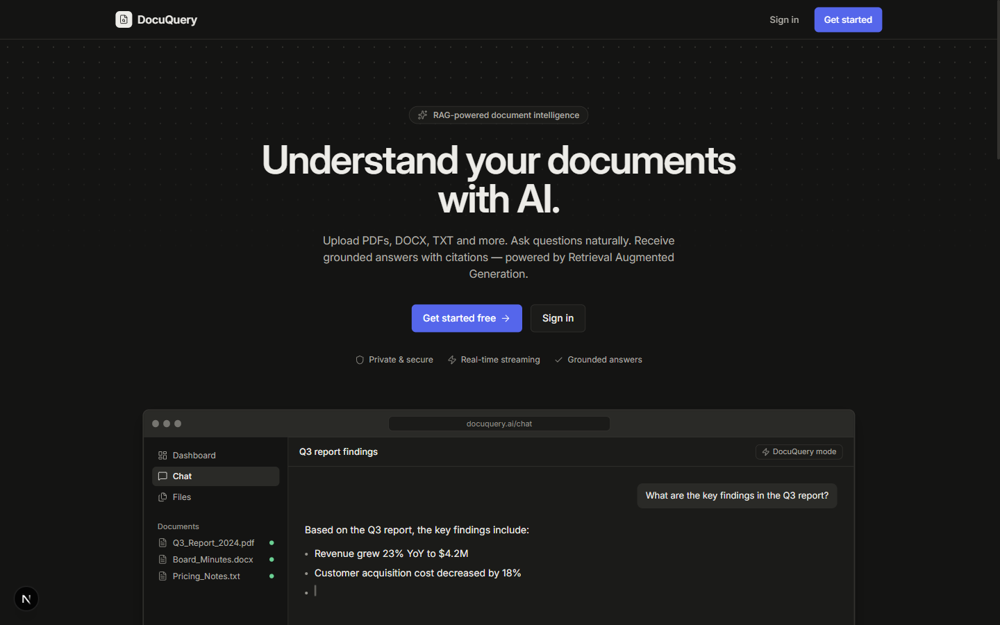
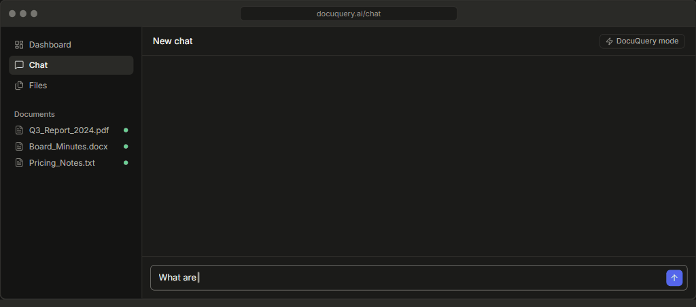
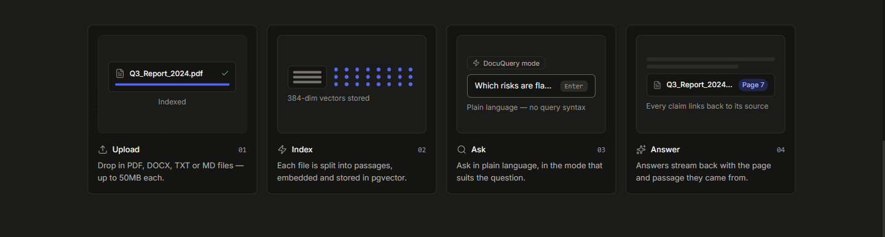

# DocuQuery

<div align="center">



### Chat with your documents. Get answers with citations.

DocuQuery is an AI-powered document question-answering application that lets you upload PDF, DOCX, TXT, and Markdown files and ask questions about their contents.

Instead of manually searching through lengthy documents, simply ask a question and receive relevant answers with references to the original source.

[Features](#features) · [How It Works](#how-it-works) · [Tech Stack](#tech-stack) · [Installation](#installation)


</div>

---

## Overview

DocuQuery uses Retrieval-Augmented Generation (RAG) to provide answers based on uploaded documents.

When a user uploads a document, the application extracts its content, divides it into smaller sections, converts those sections into numerical representations called embeddings, and stores them in a vector database.

When a question is asked, DocuQuery searches for the most relevant sections and provides them to an AI language model to generate an answer.

The generated response includes source references, allowing users to verify the information against their original documents.

## Features

- **Document Upload:** Supports PDF, DOCX, TXT, and Markdown files.
- **AI-Powered Question Answering:** Ask questions about uploaded documents using natural language.
- **Source Citations:** Answers include references to the original document, page, and relevant passage.
- **Semantic Search:** Finds relevant information based on meaning rather than exact keyword matching.
- **Multiple Chat Modes:** Choose between document-based answers, general AI responses, and hybrid responses.
- **Real-Time Streaming:** Displays AI responses as they are generated.
- **Multiple LLM Providers:** Supports Groq, OpenAI, Anthropic, Gemini, and Ollama.
- **Document Management:** Upload, view, and delete documents while tracking their indexing status.
- **Authentication:** Secure signup, login, and protected application routes.
- **Voice Input:** Ask questions using speech input.
- **Live Web Search:** Supports web search in Hybrid mode when configured.

## Demo

<div align="center">



</div>

## How It Works

<div align="center">



</div>

DocuQuery works through four main stages:

1. **Upload:** The user uploads a supported document.
2. **Process:** The backend extracts the text, cleans it, and splits it into smaller chunks.
3. **Index:** Each chunk is converted into an embedding and stored in PostgreSQL using pgvector.
4. **Retrieve and Answer:** When a question is submitted, relevant chunks are retrieved and passed to the LLM to generate an answer with citations.

## Chat Modes

| Mode | Description |
|---|---|
| **DocuQuery** | Answers questions using uploaded documents only. |
| **LLM** | Generates answers using the selected language model without document retrieval. |
| **Hybrid** | Combines document retrieval, AI reasoning, and optional live web search. |

## Tech Stack

| Category | Technologies |
|---|---|
| Frontend | Next.js, React, TypeScript |
| Styling | Tailwind CSS, Radix UI |
| Backend | Python, FastAPI |
| Database | PostgreSQL, pgvector |
| ORM & Migrations | SQLAlchemy, Alembic |
| Document Processing | PyMuPDF, python-docx |
| Embeddings | BAAI/bge-small-en-v1.5, ONNX Runtime |
| AI Integration | Groq, OpenAI, Anthropic, Gemini, Ollama |
| Authentication | HTTP-only session cookies, PBKDF2-SHA256 |
| Deployment | Railway, Vercel |

## Installation

### Prerequisites

- Node.js 20+
- Python 3.13+
- Docker Desktop
- Groq API key (or an API key from another supported LLM provider)

### 1. Clone the Repository

```bash
git clone https://github.com/Devadharshini784/knowdex.git
cd knowdex
```

### 2. Start the Frontend

```bash
cd frontend
npm install
npm run dev
```

Open `http://localhost:3000` in your browser.

### 3. Configure the Backend

Open a new terminal:

```bash
cd backend
```

Create the environment file:

```bash
cp .env.example .env
```

Configure the required database and LLM settings in `.env`.

### 4. Start the Backend

Using Docker:

```bash
docker compose up --build
```

Run database migrations:

```bash
docker compose exec api python -m alembic upgrade head
```

The backend will be available at:

`http://localhost:8000`

API documentation:

`http://localhost:8000/docs`

## API Endpoints

| Method | Endpoint | Description |
|---|---|---|
| POST | `/auth/signup` | Register a new user |
| POST | `/auth/login` | Authenticate a user |
| POST | `/auth/logout` | End the user session |
| GET | `/auth/me` | Get authenticated user details |
| POST | `/upload` | Upload and process documents |
| GET | `/documents` | List uploaded documents |
| GET | `/documents/{id}` | Get document details |
| DELETE | `/documents/{id}` | Delete a document |
| POST | `/retrieve` | Search relevant document sections |
| POST | `/chat` | Generate AI responses with citations |
| GET | `/health` | Check backend health |

## Running Tests

Backend:

```bash
cd backend
pytest -q
```

Frontend:

```bash
cd frontend
npx tsc --noEmit
npm run lint
npm run build
```

## Contributing

Contributions are welcome!

1. Fork the repository.
2. Create a new feature branch.
3. Make your changes.
4. Test your changes.
5. Submit a pull request.

---

<div align="center">

**Built with Next.js, FastAPI, PostgreSQL, pgvector, and AI.**

</div>